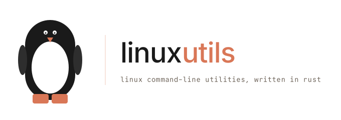

<picture>
  <source media="(prefers-color-scheme: dark)" srcset="docs/branding/banner-dark.svg">
  
</picture>


# linuxutils

A collection of Linux utilities written in Rust, drop-in compatible with the
standard Linux toolbox. The bulk of the tools come from
[util-linux](https://github.com/util-linux/util-linux), with kernel module
tools from [kmod](https://git.kernel.org/pub/scm/utils/kernel/kmod/kmod.git)
also planned.

Tools are grouped into per-category crates (such as `linuxutils-disk` and
`linuxutils-system`) with one cargo feature per tool, so you can install the
full bundle or pick individual tools. ABI-compatible reimplementations of the
original C libraries are also provided as cdylibs for FFI consumers.

## Project Structure

### Group crates

Each group crate contains every tool in its category as a feature-gated module
and binary. All tools are enabled by default. To select individual tools, use
`--no-default-features --features <tool>`.

| Directory | Crate | Tools |
|-----------|-------|-------|
| `disk/` | `linuxutils-disk` | `blockdev`, `isosize`, `mount`, `umount` |
| `kmod/` | `linuxutils-kmod` | _planned: `lsmod`, `modinfo`, `modprobe`, `insmod`, `rmmod`, `depmod`_ |
| `login/` | `linuxutils-login` | `nologin` |
| `misc/` | `linuxutils-misc` | `blkid`, `cal`, `copyfilerange`, `exch`, `fincore`, `findfs`, `findmnt`, `getino`, `getopt`, `kill`, `logger`, `look`, `lslocks`, `mcookie`, `namei`, `rename`, `uuidgen`, `uuidparse`, `waitpid`, `whereis` |
| `sched/` | `linuxutils-sched` | `chrt`, `ionice`, `taskset` |
| `system/` | `linuxutils-system` | `blkdiscard`, `choom`, `ctrlaltdel`, `dmesg`, `eject`, `fadvise`, `fallocate`, `flock`, `fsfreeze`, `fstrim`, `ipcmk`, `ipcrm`, `ipcs`, `losetup`, `lscpu`, `lsipc`, `lsirq`, `lsmem`, `lsns`, `mountpoint`, `nsenter`, `pipesz`, `pivot_root`, `prlimit`, `renice`, `rfkill`, `setarch`, `setpgid`, `setsid`, `swapoff`, `swapon`, `unshare`, `wdctl` |
| `term/` | `linuxutils-term` | `mesg`, `wall`, `write` |
| `text/` | `linuxutils-text` | `bits`, `colrm`, `column`, `hexdump`, `line`, `rev` |

### Libraries

Rust libraries shared by the tools above.

| Directory | Crate | Purpose |
|-----------|-------|---------|
| `libs/blkid/` | `linuxutils-blkid` | Block device tag resolution (`LABEL=`, `UUID=` and friends) |
| `libs/mount/` | `linuxutils-mount` | Parsing of fstab and mountinfo, and wrappers for the mount syscalls |

### ABI-compatible C library reimplementations

Built as cdylibs for FFI consumers, as drop-in replacements for the upstream
shared libraries. These are not published to crates.io, and most are still
incomplete. See [TOOLS.md](TOOLS.md#libraries) for the status of each.

| Directory | Crate | Replaces |
|-----------|-------|----------|
| `compat/libblkid/` | `linuxutils-libblkid` | `libblkid.so.1` |
| `compat/libfdisk/` | `linuxutils-libfdisk` | `libfdisk.so.1` |
| `compat/libkmod/` | `linuxutils-libkmod` | `libkmod.so.2` |
| `compat/libmount/` | `linuxutils-libmount` | `libmount.so.1` |
| `compat/libsmartcols/` | `linuxutils-libsmartcols` | `libsmartcols.so.1` |
| `compat/libuuid/` | `linuxutils-libuuid` | `libuuid.so.1` |

### Other crates

| Directory | Crate | Purpose |
|-----------|-------|---------|
| `common/` | `linuxutils-common` | Shared types (`ManContent`, `HELP_WIDTH_MAX`) used by every tool |
| `linuxutils/` | `linuxutils` | Multicall binary that dispatches to any tool by `argv[0]` or as a subcommand |
| `testutil/` | `testutil` | Test helpers (not published) |
| `xtask/` | `xtask` | Developer tasks such as man page generation (not published) |

All published crates are prefixed with `linuxutils-` to avoid naming collisions
on crates.io.

## Status

See [TOOLS.md](TOOLS.md) for a full list of tools, libraries, and their
implementation status.

## Installation

### Full bundle (all tools in a group)

```sh
cargo install linuxutils-disk
cargo install linuxutils-system
# ... etc.
```

### Single tool

Each group crate exposes one feature per tool. Disable the default features
and pick the ones you want:

```sh
cargo install linuxutils-system --no-default-features --features lscpu
cargo install linuxutils-disk --no-default-features --features blockdev
```

### Multicall binary

A single `linuxutils` binary that can run any tool. This is useful for
container images and minimal installs:

```sh
cargo install linuxutils
linuxutils lscpu
```

You can also symlink it under a tool's name, for example to
`/usr/local/bin/lscpu`, and call that directly. `linuxutils --list` prints the
name of every tool it can run.

## Building from source

### With Cargo

```sh
cargo build --workspace
cargo test --workspace
cargo xtask mangen target/man   # generate man pages
```

### With Nix

Individual tool binaries (one binary per tool) plus cdylibs and man pages:

```sh
nix build .#linuxutils
```

Multicall binary plus per-tool symlinks, cdylibs, and man pages:

```sh
nix build .#linuxutils-multicall
```

Development shell with cargo, rustc, clippy, rustfmt, and cargo-nextest:

```sh
nix develop
```

## License

This project is licensed under the [MIT License](LICENSE.md).

Some files included for ABI compatibility (such as the header files in
`compat/*/include/`) are copied from util-linux and keep their original license
terms. See the individual file headers for details.

No original util-linux source code was referenced during development. The only
data used was public API documentation, and running the compiled tools to
observe their external behavior.
